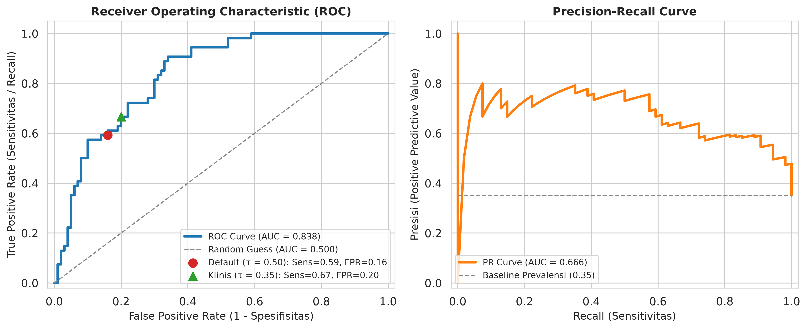
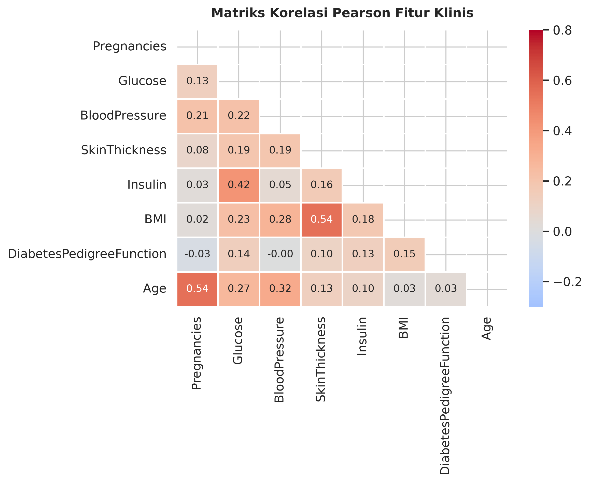
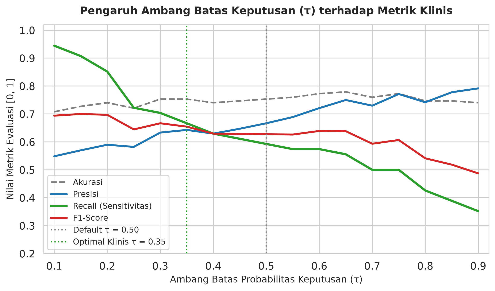

# Klasifikasi Risiko Diabetes dengan Gaussian Naïve Bayes

Model klasifikasi biner berbasis Gaussian Naïve Bayes pada **Pima Indians Diabetes Database** ($n = 768$, 8 fitur klinis). Proyek ini menguji perilaku model probabilistik parametrik saat berhadapan dengan data medis yang berkorelasi dan tidak seimbang, dengan alur imputasi bebas kebocoran data (*zero data leakage*) serta penalaan ambang batas keputusan (*threshold tuning*) untuk menekan kasus *False Negative*.

Pada evaluasi uji terstratifikasi ($n = 154$), model mencapai akurasi **75,32%** dan **AUC-ROC 0,838**. Penurunan ambang batas probabilitas dari baku $0{,}50$ ke $0{,}35$ menjaga akurasi di **75,32%**, menaikkan *Recall* dari **59,26%** menjadi **66,67%**, dan memangkas kasus diabetes yang gagal terdeteksi dari 22 menjadi 18 pasien.

---

## Permasalahan Data & Pencegahan Kebocoran

Dataset *Pima Indians Diabetes* memuat 768 catatan pasien perempuan dewasa (500 negatif atau 65,1%, dan 268 positif atau 34,9%) dengan delapan pengukuran klinis: `Pregnancies`, `Glucose`, `BloodPressure`, `SkinThickness`, `Insulin`, `BMI`, `DiabetesPedigreeFunction`, dan `Age`.

Lima variabel fisiologis (`Glucose`, `BloodPressure`, `SkinThickness`, `Insulin`, `BMI`) mengandung nilai `0` yang tidak mungkin terjadi secara biologis, seperti kadar glukosa atau indeks massa tubuh bernilai nol. Angka nol tersebut menandakan entri yang hilang saat pengukuran.

Jika median dihitung sebelum pembagian data, statistik dari data uji ikut membentuk nilai imputasi latih dan memicu kebocoran informasi (*data leakage*). Untuk mencegahnya, `ClinicalImputer` selalu dipasang setelah pemisahan stratifikasi 80:20 (`614` data latih, `154` data uji) dan juga dibungkus ke dalam `sklearn.pipeline.Pipeline` di setiap lipatan validasi silang. Dengan cara ini, nilai median non-nol hanya diestimasi dari data latih pada masing-masing lipatan, sementara angka `0` pada `Pregnancies` tetap dipertahankan sebagai nilai klinis yang valid.

---

## Formulasi Model & Kompleksitas Parameter

Untuk vektor fitur $\mathbf{x} = (x_1, \dots, x_8)$, klasifikasi *Maximum A Posteriori* (MAP) membandingkan probabilitas posterior setiap kelas $c \in \{0, 1\}$. Dengan asumsi independensi bersyarat antarfitur dan distribusi normal pada masing-masing prediktor, aturan keputusan dihitung dalam ruang logaritma untuk mencegah *floating-point underflow*:

$$\hat{y} = \arg\max_{c \in \{0, 1\}} \left[ \ln P(Y = c) - \frac{1}{2} \sum_{j=1}^{8} \left( \ln(2\pi \sigma_{j,c}^2) + \frac{(x_j - \mu_{j,c})^2}{\sigma_{j,c}^2} \right) \right]$$

Di sini, Gaussian Naïve Bayes hanya perlu mengestimasi $2d = 16$ parameter rata-rata dan variansi per kelas (32 parameter likelihood ditambah 2 probabilitas *prior*), jauh lebih ringkas dibandingkan model kovarians penuh seperti *Quadratic Discriminant Analysis* (QDA) yang membutuhkan estimasi $d(d+1)/2 = 36$ entri matriks kovarians per kelas. Untuk stabilitas numerik saat membagi variansi, faktor pengaman `var_smoothing = 1e-9` ditambahkan ke seluruh fitur.

### Parameter Terlatih (Data Latih, $n = 614$)

Prior kelas pada set latih tercatat sebesar $P(Y=0) = 0{,}6515$ dan $P(Y=1) = 0{,}3485$. Tabel berikut merangkum rata-rata dan simpangan baku ($\mu \pm \sigma$) yang dipelajari model pada tiap kelas:

| Fitur Klinis | Kelas 0: Negatif ($n = 400$) | Kelas 1: Positif ($n = 214$) |
| :--- | :---: | :---: |
| `Glucose` (mg/dL) | $111{,}86 \pm 24{,}39$ | $141{,}33 \pm 29{,}88$ |
| `BMI` (kg/m²) | $30{,}85 \pm 6{,}62$ | $35{,}27 \pm 6{,}48$ |
| `Age` (tahun) | $31{,}42 \pm 11{,}96$ | $37{,}40 \pm 11{,}08$ |
| `Insulin` ($\mu$U/mL) | $127{,}56 \pm 66{,}37$ | $156{,}96 \pm 87{,}26$ |
| `Pregnancies` (kali) | $3{,}27 \pm 3{,}00$ | $4{,}96 \pm 3{,}77$ |
| `BloodPressure` (mmHg) | $71{,}13 \pm 11{,}82$ | $75{,}48 \pm 12{,}17$ |
| `SkinThickness` (mm) | $27{,}50 \pm 8{,}59$ | $31{,}52 \pm 8{,}76$ |
| `DiabetesPedigreeFunction` | $0{,}42 \pm 0{,}28$ | $0{,}55 \pm 0{,}35$ |

Kadar `Glucose` memberi pemisahan kelas paling tajam dengan selisih rata-rata hampir $30\text{ mg/dL}$ antara kelompok sehat dan positif diabetes.

---

## Hasil Evaluasi

Kinerja model diukur pada data uji terpisah ($n = 154$: 100 negatif, 54 positif) serta diuji stabilitasnya lewat validasi silang berstrata 5 lipatan (*5-Fold Stratified Cross-Validation*).

| Skema Evaluasi | Akurasi | Presisi | *Recall* | *F1-Score* | Catatan Tambahan |
| :--- | :---: | :---: | :---: | :---: | :--- |
| Uji Terpisah ($\tau = 0{,}50$) | 75,32% | 66,67% | 59,26% | 62,75% | AUC-ROC 0,838 \| PR-AUC 0,666 |
| Validasi Silang 5-Lipat | 74,35% $\pm$ 3,70% | 64,49% $\pm$ 6,07% | 59,37% $\pm$ 7,20% | 61,69% $\pm$ 5,92% | Pipeline + Imputer per lipatan |

Pada ambang batas baku $\tau = 0{,}50$, matriks konfusi data uji mencatat **32 True Positive**, **84 True Negative**, **16 False Positive**, dan **22 False Negative**.



Kurva ROC di atas menunjukkan kemampuan diskriminasi peringkat yang kuat (AUC 0,838), sedangkan kurva *Precision-Recall* tetap berada jauh di atas garis dasar prevalensi kelas positif (AUC 0,666 berbanding *baseline* 0,35).

---

## Pelanggaran Asumsi Independensi & Bedah Galat

Data medis jarang memenuhi asumsi bahwa seluruh gejala berdiri saling bebas. Pada matriks korelasi Pearson setelah imputasi, pasangan fitur `Age` dan `Pregnancies` ($r = 0{,}54$), `BMI` dan `SkinThickness` ($r = 0{,}54$), serta `Glucose` dan `Insulin` ($r = 0{,}42$) berkorelasi positif cukup jelas.



Akibatnya, informasi yang sebenarnya tumpang tindih ikut terhitung ganda dalam perkalian *likelihood* dan mendorong probabilitas posterior terlalu mendekati 0 atau 1. Meski kalibrasi probabilitasnya bergeser, batas keputusan klasifikasi ($\arg\max$) masih bertahan baik pada 74%–75% akurasi karena estimasi variansi yang ringkas tidak mudah *overfit* pada sampel berukuran sedang.

Dari 38 kesalahan klasifikasi pada data uji, **22 kasus berupa *False Negative*** (pasien positif yang diprediksi sehat). Penelusuran lebih dekat memperlihatkan pola yang konsisten: rata-rata `Glucose` kelompok *False Negative* berada di **130,09 mg/dL** dengan rata-rata `BMI` **33,28 kg/m²** dan usia **32,09 tahun**. Nilai tersebut berada persis di daerah tumpang tindih antara kelas sehat dan kelas diabetes, sehingga bobot prior kelas sehat sebesar 65,15% cukup untuk menarik prediksi ke kelas negatif saat memakai ambang baku $\tau = 0{,}50$.

---

## Penalaan Ambang Batas untuk Konteks Klinis

Dalam skenario penapisan awal diabetes, gagal mendeteksi pasien sakit (*False Negative*) membawa risiko yang jauh lebih tinggi daripada pemeriksaan lanjutan pada pasien sehat (*False Positive*). Menggeser ambang batas keputusan $\tau$ mengubah titik kerja model pada kurva ROC tanpa melatih ulang parameter.



| Ambang Batas ($\tau$) | Akurasi | Presisi | *Recall* | *F1-Score* | False Positive | False Negative |
| :---: | :---: | :---: | :---: | :---: | :---: | :---: |
| **0,50** (Baku) | 75,32% | 66,67% | 59,26% | 62,75% | 16 | 22 |
| **0,35** (Rekomendasi Klinis) | 75,32% | 64,29% | **66,67%** | **65,45%** | 20 | **18** |
| **0,30** (Sensitif Tinggi) | 75,32% | 63,33% | 70,37% | 66,67% | 22 | 16 |

Pemilihan $\tau = 0{,}35$ menjaga akurasi keseluruhan tetap di **75,32%** sambil menaikkan sensitivitas (*Recall*) dari **59,26%** ke **66,67%** dan *F1-Score* ke **65,45%**, menukar 4 kasus *False Positive* tambahan dengan berkurangnya 4 kasus diabetes yang terlewat.

---

## Simulasi Naïve Bayes Kategorikal (*Laplace Smoothing*)

Selain implementasi fitur kontinu, repositori ini menyertakan skrip pembanding untuk kasus diskrit (`scripts/simulate_categorical_nb.py`) pada dataset kanonik *Play Tennis* ($N = 14$). Simulasi tersebut membandingkan estimasi frekuensi empiris murni terhadap *Laplace smoothing* ($\alpha = 1$) saat muncul atribut dengan probabilitas nol di salah satu kelas (`Cuaca = Mendung`, frekuensi kelas `Tidak` = 0/5). Tanpa pemulusan, posterior runtuh ke 100% vs 0% dan menghapus bukti dari fitur lain; penerapan $\alpha = 1$ memulihkan peluang posterior menjadi 72,16% vs 27,84% dengan akurasi evaluasi 92,86%.

---

## Menjalankan Proyek & Pengujian

Proyek ini membutuhkan Python 3.10 atau lebih baru. Pasang dependensi pada lingkungan virtual baru sebelum menjalankan pipeline:

```bash
python3 -m venv .venv
source .venv/bin/activate
pip install -r requirements.txt
```

Jalankan eksperimen utama beserta evaluasi lengkap, atau sesuaikan ukuran partisi dan jumlah lipatan validasi silang lewat argumen CLI:

```bash
python3 run_experiment.py
python3 run_experiment.py --test-size 0.20 --cv-folds 5 --random-state 42 --save-processed
```

Untuk menjalankan simulasi varian kategorikal dengan *Laplace smoothing* serta rangkaian pengujian unit otomatis:

```bash
python3 scripts/simulate_categorical_nb.py
pytest -v
```

Seluruh konfigurasi parameter eksperimen dapat diubah pada berkas `config/params.yaml`, sementara hasil eksplorasi interaktif beserta pembangkitan grafik tersedia di `notebooks/01_evaluasi_model_naive_bayes.ipynb`.

---

## Referensi

- Agarwal, C., et al. (2022). *OpenXAI: Towards a Transparent Evaluation of Model Explanations*. Harvard Dataverse (`doi:10.7910/DVN/HIBCFL`).
- Smith, J. W., et al. (1988). *Using the ADAP Learning Algorithm to Forecast the Onset of Diabetes Mellitus*. National Institute of Diabetes and Digestive and Kidney Diseases.
- Bishop, C. M. (2006). *Pattern Recognition and Machine Learning*. Springer.
- Hand, D. J., & Yu, K. (2001). *Idiot's Bayes: Not So Stupid After All?* International Statistical Review, 69(3), 385–398.
- Hastie, T., Tibshirani, R., & Friedman, J. (2009). *The Elements of Statistical Learning*. Springer.

## Lisensi

Dirilis di bawah lisensi [MIT](LICENSE).
